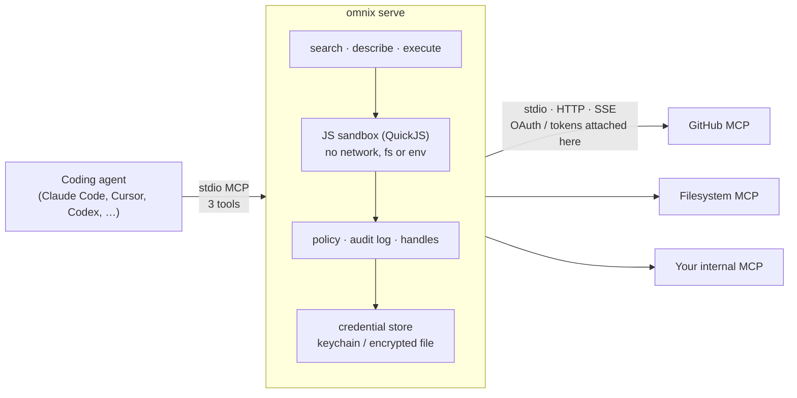

<p align="center">
  <picture>
    <source media="(prefers-color-scheme: dark)" srcset="assets/logo-dark.svg">
    
  </picture>
</p>

<p align="center">
  <b>One door to all your MCP servers.</b><br>
  A local MCP gateway that replaces dozens of tool definitions with three tools,<br>
  and lets the model write code instead of chaining calls through its context window.
</p>

<p align="center">
  <a href="https://github.com/estradax/omnix/actions/workflows/ci.yml"></a>
  
  
</p>

---

## The problem

Connect an agent to ten MCP servers and every tool definition from every server lands in the prompt, on every
turn, whether or not the task needs it. Then each call's full result flows back through the model before the
next call can happen, even when the model only wanted to filter it, count it, or hand it to the next tool.

`omnix` sits between your agent and your MCP servers and changes the shape of that interaction. This idea is
called *code mode*; see [Prior art](#prior-art).

## How it works



The agent sees exactly three tools:

| Tool | What it does |
|---|---|
| `search` | Keyword search (BM25) over every upstream tool. Returns `server.tool` ids with a one-line description. |
| `describe` | Returns the TypeScript signature and full description for the tools you ask about. |
| `execute` | Runs JavaScript in a sandbox where each upstream server is a global. Only the return value, console output and the list of methods called come back. |

So instead of ten calls whose results all pass through the model, it writes one program:

```js
// the model writes this; intermediate data never enters its context
const files = await drive.search({ query: "Q3 report" });
const docs  = await Promise.all(files.slice(0, 3).map(f => drive.read({ id: f.id })));
state.lastSearch = files;                       // `state` persists between runs
return docs.map(d => ({ title: d.title, words: d.text.split(/\s+/).length }));
```

Credentials never enter the sandbox. The host attaches them when it proxies each call. Binary results
(images, audio) stay on the host as `{ $handle, mimeType, size }`, and a handle placed in a later call's
arguments is swapped for its bytes host-side.

## Does it help? A reproducible benchmark

Setup: 5 deterministic mock servers, 110 tools, and one task: *list 500 records, keep the active ones, return the
count and the first three names.* Run it yourself with
`cargo test --test bench -- --include-ignored --nocapture`.

| Context cost | Direct | Via omnix | Ratio |
|---|---:|---:|---:|
| Tool definitions | 105,940 B (~26k tokens) | 839 B (~210) | 126× |
| Task flow (call + results) | 135,351 B | 1,359 B | 100× |
| **Total** | **241,291 B (~60k tokens)** | **2,198 B (~552)** | **110×** |

Read this with the caveats, not just the headline. Tokens are estimated at 4 characters each. The task is
deliberately favourable to code mode (a large intermediate result). Some clients already defer or lazy-load tool
definitions, which shrinks the first row. **The benchmark measures context size only, not answer quality, and
not how many turns a real model needs to find the right tool.** Methodology and limits are in
[docs/BENCHMARK.md](docs/BENCHMARK.md).

## Install

`omnix` is a single Rust binary. It is not on crates.io yet.

```sh
cargo install --git https://github.com/estradax/omnix
```

It is developed on stable Rust (1.99). The minimum supported version has not been checked.

## Quick start

```sh
# 1. See which agent configs omnix found, and what it would change. Nothing is written.
omnix setup --list
omnix setup --dry-run

# 2. Apply it. You get a diff and a y/N prompt per file; backups are kept.
omnix setup

# 3. Check every upstream connection.
omnix doctor

# 4. Log in to servers configured with auth.type = "oauth" (opens a browser once).
omnix login notes
```

`setup` replaces each agent's MCP servers with a single `omnix` entry and moves the originals into omnix's own
config, so no tool disappears. `omnix setup --remove` puts them back. Restart your agent afterwards.

Or add servers by hand:

```sh
omnix add fs --command npx --arg -y --arg @modelcontextprotocol/server-filesystem --arg .
omnix add notes --url https://mcp.example.com/mcp --oauth
omnix find "read file"          # try the search the model will use
omnix sdk --out omnix.d.ts      # TypeScript declarations for editor tooling
```

### Supported agents

`omnix setup` knows the config files of Claude Code, Cursor, VS Code / Copilot, OpenAI Codex CLI, OpenCode,
Windsurf, Gemini CLI, Zed, Kiro, Amp and Cline. **These file formats were written from documentation recall
and have not all been verified against each vendor's current docs.** That is why `setup` always shows a diff
first, and why it will not touch a file that contains comments (JSONC): it skips it and prints the snippet for
you to paste.

## Configuration

omnix reads, in increasing priority: the configs of the agents above (imported, so you can start without writing
anything), the global `config.json` in the omnix config directory, and `./omnix.json` in the project. The native
file is JSON5:

```json5
{
  "servers": {
    "fs":       { "command": "npx", "args": ["-y", "@modelcontextprotocol/server-filesystem", "."] },
    "internal": { "url": "https://mcp.example.com/mcp",
                  "auth": { "type": "bearer", "token": "cmd:op read op://dev/mcp/token" } },
    "notes":    { "url": "https://notes.example.com/mcp", "auth": { "type": "oauth" } },
    "legacy":   { "url": "https://old.example.com/sse", "transport": "sse" }
  },
  "policy": {
    "read_only": true,
    "allow": ["fs.write_file"],
    "deny":  ["*.delete*"],
    "before_call": "./scripts/check-call.sh",
    "audit_log": "audit.jsonl"
  }
}
```

`${VAR}` and `${VAR:-default}` are expanded in commands, args, URLs, env and headers. Any credential field also
accepts a **secret reference**: `env:NAME`, `file:/path`, or `cmd:<shell command>` (for example a 1Password or
`pass` lookup). The `omnix` entry that `setup` adds is skipped on load so the gateway never wraps itself.

### Authentication

| Method | Config | Notes |
|---|---|---|
| None | _(default)_ | |
| Bearer token | `{"type":"bearer","token":…}` | |
| API key header / query | `{"type":"header","name":…,"value":…}` / `{"type":"query",…}` | |
| Basic auth | `{"type":"basic","username":…,"password":…}` | |
| Custom headers | `"headers": {…}` on any HTTP server | |
| stdio env | `"env": {…}` | values may be secret references |
| OAuth 2.1 authorization code + PKCE | `{"type":"oauth"}` | `omnix login <server>`. Protected-resource and authorization-server discovery, resource indicators, `iss` validation, refresh with rotation, scope step-up (`--scope`). Client registration order: pre-registered `client_id`/`client_secret` → Client ID Metadata Document → Dynamic Client Registration. |
| Device authorization (RFC 8628) | `omnix login <server> --device` | For headless/SSH machines. **Not part of the MCP spec**: only works if the authorization server advertises a device endpoint, and needs a pre-registered `client_id`. |
| Client credentials | `{"type":"client_credentials","client_id":…,"client_secret":…}` | Machine to machine. Also `private_key_jwt` with `"private_key"` and `"algorithm"` (RS256/384/512, ES256/384). Re-exchanges before expiry. |

`omnix serve` never opens a browser and never blocks on a missing login: if a token is absent, that server is
skipped and `omnix doctor` / the `search` output tell you to run `omnix login <server>`. Tokens go in the OS
keychain, falling back to a ChaCha20-Poly1305 encrypted file with `0600` permissions when no keychain exists
(headless boxes). Set `OMNIX_PASSPHRASE` to derive that file's key from a passphrase; otherwise a random key file
next to it is used, which only protects against the credentials file being copied on its own.

> **Honest status of auth:** every flow above is covered by automated tests against mock servers written for this
> project (including PKCE, `iss`, refresh-token rotation, JWT signature checks, device polling and step-up).
> None has been run against a production provider yet, and enterprise-managed authorization (ID-JAG) is not
> implemented. Treat it as alpha.

### Policy

For `server.tool`, in order: a `deny` match blocks it; if `allow` is non-empty only matches pass (an explicit
allow beats annotations); in `read_only` mode only tools the server marks `readOnlyHint: true` pass, so
**unannotated tools are blocked** (fail closed); otherwise it is allowed. Patterns use `*` wildcards.
`before_call` is a command that receives `{server, tool, args}` on stdin; exit 0 allows, anything else blocks, and a
hook that crashes or times out blocks. Blocked tools disappear from `search`/`describe` and fail at call time with
a `policy:` error. The audit log is JSONL and records argument **keys, never values**.

## Security model

- **Sandbox.** User code runs in [QuickJS](https://bellard.org/quickjs/) via `rquickjs`, in-process, with no
  network, filesystem, process or env access. The only host capabilities are proxied upstream calls (checked
  against the configured server list) and a bounded `console`. Limits: 30 s wall time, 200 calls, 64 KB of code,
  64 MB of memory, 32 KB of returned result, 1,000 log lines. On timeout the whole runtime is rebuilt, so
  runaway loops and microtask floods cannot poison later runs. An adversarial test suite covers constructor and
  prototype escapes, internals tampering, memory/stack exhaustion, call-limit evasion and result forging.
- **What that does not give you.** QuickJS is a library, not a hardware or OS boundary. A bug in the engine itself
  would not be contained. For that threat, run omnix inside a container or VM. A WASM-isolated engine (wasmtime)
  was considered and not built.
- **Credentials** are resolved on the host, held in zeroized buffers, never logged and never visible to the sandbox.
- **Prompt injection still applies.** The model's code runs with the permissions of every upstream server you
  connect. Tool output is untrusted data. Use `policy` to remove capabilities you would not want a confused or
  manipulated model to have.
- **`setup` edits files outside this repo** (your agents' configs). It prints a diff, asks first, backs up, preserves
  unknown keys, refuses non-interactive runs without `--yes`, and is undoable with `--remove`.

Report vulnerabilities privately, see [SECURITY.md](SECURITY.md).

## Commands

| Command | |
|---|---|
| `omnix serve` | Run the gateway on stdio. This is what agents launch. It answers the handshake immediately and connects upstreams in the background. `search`/`describe` use an on-disk catalog cache until they are up. |
| `omnix setup [--agent X] [--dry-run] [--yes] [--keep-existing] [--remove] [--list]` | Point agents at the gateway, or undo it. |
| `omnix doctor` | Config sources, policy, credential store, and a live status line per server. |
| `omnix login <server> [--no-browser] [--device] [--scope S]` / `logout <server>` | OAuth login / forget credentials. |
| `omnix list` · `find <query>` · `sdk [--out FILE]` | Inspect servers, try a search, emit `.d.ts`. |
| `omnix add NAME (--command C … \| --url U …)` · `remove NAME` | Edit `omnix.json` (`--global` for the global config). |

Environment: `OMNIX_CONFIG_DIR` (config and credentials location), `OMNIX_CREDENTIAL_STORE=file|keychain`,
`OMNIX_PASSPHRASE`, `OMNIX_CATALOG_CACHE=off`.

## Status and known limitations

This is alpha software. Specifically:

- **Not yet used against real servers.** Everything is tested with mocks. Expect rough edges with real MCP servers
  and OAuth providers.
- **Agent config formats are partly unverified** (see above). `setup` is built to fail safe, not to be infallible.
- **The OS keychain backend has not been exercised by the tests**, which use the file backend.
- **Client-credentials re-exchange before expiry** has no timed test.
- **Binary handles are never freed** within a session (64 MB cap), and policy changes need a restart.
- **A cached `search` can briefly suggest a tool an upstream has since removed** until the live connection finishes.
- Legacy SSE supports static credentials only (no OAuth).
- Windows is untested.

## Development

```sh
cargo test                                   # unit + end-to-end (spawns real child processes)
cargo test --test bench -- --include-ignored --nocapture
cargo clippy --all-targets && cargo fmt --check
```

The end-to-end tests drive `omnix` as a child process against mock MCP, OAuth and legacy-SSE servers in `tests/`
and `src/bin/`. See [CONTRIBUTING.md](CONTRIBUTING.md).

## Prior art

omnix builds on ideas from Cloudflare's [Code Mode](https://blog.cloudflare.com/code-mode/) and Anthropic's
[Code execution with MCP](https://www.anthropic.com/engineering/code-execution-with-mcp), and was written with
[minkaworks/mcptocodemode](https://github.com/minkaworks/mcptocodemode) as a reference for the overall shape. The
MCP client and OAuth building blocks come from the official Rust SDK, [`rmcp`](https://crates.io/crates/rmcp).

## License

Licensed under either of [Apache License 2.0](LICENSE-APACHE) or [MIT license](LICENSE-MIT), at your option.
Unless you state otherwise, any contribution you submit for inclusion is dual-licensed as above, without any
additional terms.
